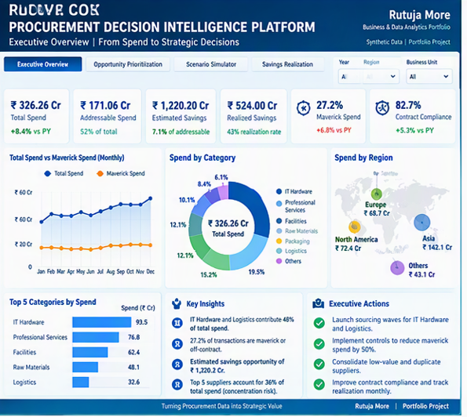

# Procurement Decision Intelligence Platform

A senior-level procurement analytics portfolio project demonstrating how spend, supplier performance, commercial opportunities, sourcing scenarios, risk and savings realization can be converted into executive decision support.

> This project uses fully synthetic data. It contains no employer, client, supplier or confidential information.

## Executive Summary

Procurement teams often have visibility into historical spend but limited support for deciding:

- Which categories should be prioritized for sourcing?
- Where does supplier concentration create risk?
- Which award scenario balances savings and resilience?
- How much identified value becomes realized savings?
- Which suppliers require management intervention?

This project addresses those questions through a decision-intelligence platform combining Power BI, advanced SQL, sourcing scenarios, supplier-risk analytics and savings governance.

## Dashboard Preview

## Business Decisions Supported

- Prioritize risk-adjusted sourcing opportunities
- Identify maverick and off-contract spend
- Compare maximum-savings, balanced and resilience scenarios
- Monitor supplier exposure and performance
- Track savings from identified through realized
- Explain savings leakage
- Provide executive recommendations

## Solution Components

- Multi-dimensional procurement dataset
- Category opportunity register
- Supplier risk and resilience model
- Strategic sourcing scenario simulator
- Savings-realization pipeline
- Reconciliation controls
- Power BI semantic model
- DAX measure catalogue
- SQL analysis library
- Executive decision dashboard

## Power BI Page

### 1. Executive Overview
### 2. Opportunity Prioritization
### 3. Strategic Sourcing Scenario Simulator
### 4. Supplier Risk and Resilience




## Data Model

The analytical model contains:

- Opportunities
- Sourcing Scenarios
- Savings Pipeline
- Supplier Risk
- Executive Metrics
- Dedicated DAX measures

## Technical Skills Demonstrated

- Power BI
- DAX
- Power Query
- Advanced SQL
- Data modelling
- Procurement analytics
- Strategic sourcing
- Supplier-risk analysis
- Scenario modelling
- Savings governance
- Stakeholder reporting
- Executive storytelling

## SQL Analysis

The SQL library demonstrates:

- CTEs
- Window functions
- Supplier ranking
- Pareto analysis
- Running totals
- LAG-based price analysis
- Risk-adjusted benefit calculations
- Scenario comparison
- Savings leakage
- Reconciliation controls

## Key DAX Measures

- Addressable Spend
- Estimated Savings
- Risk-Adjusted Benefit
- Recommended Scenario Savings
- Identified Savings
- Implemented Savings
- Realized Savings
- Savings Leakage
- Realization Rate
- High-Risk Supplier Count
- Supplier Priority Score

## Assumptions and Limitations

- All data is synthetic.
- Sourcing-scenario assumptions are illustrative.
- Fixed and simplified conversion factors are used where required.
- External financial, sanctions, ESG and geopolitical data is excluded.
- Real savings require Finance-approved baselines and implementation evidence.
- A production implementation would require security, lineage, refresh monitoring, testing and change control.

## Repository Structure

```text
data/           Source datasets
dashboard/      Power BI and Excel dashboard files
dax/            DAX measure library
sql/            Advanced SQL scripts
power_query/    Power Query templates
theme/          Power BI JSON theme
documentation/  Requirements, model and governance documentation
screenshots/    Dashboard images
case_study/     Interview walkthrough
```
